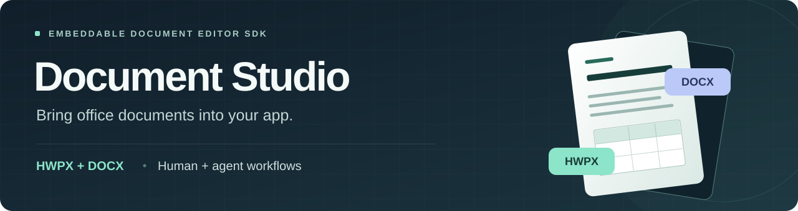
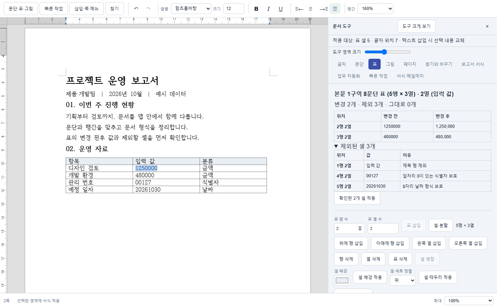
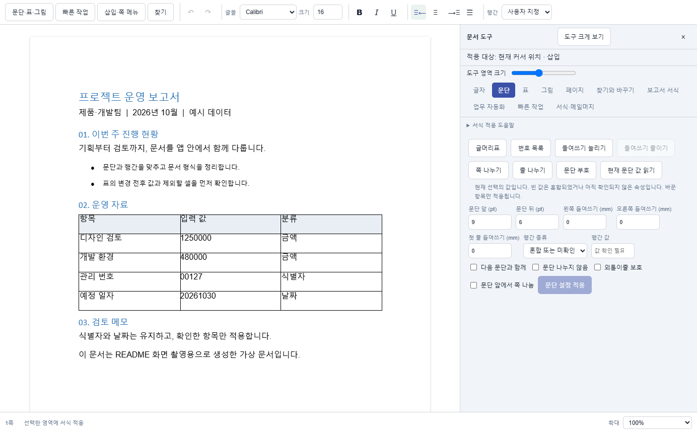

<p align="center">
  
</p>

<p align="center"><strong>Your app's UI. HWPX and DOCX in one editor. Shared APIs for people and agents.</strong></p>

<p align="center">
  <a href="https://github.com/seongbeom-kr/document-studio/actions/workflows/verify.yml"></a>
  <a href="LICENSE"></a>
  <a href="packages/core"></a>
  <a href="docs/release-guide.md"></a>
</p>

<p align="center">
  <a href="#quick-start">Quick start</a> · <a href="#embed-in-your-app">Integration</a> · <a href="#agent-api">Agent API</a> · <a href="#scope-and-validation">Scope</a> · <a href="#contributing">Contributing</a>
</p>

<p align="center"><a href="README.md">한국어</a> · <strong>English</strong></p>

---

**Document Studio** is an open-source **HWPX and DOCX document editor SDK** for web applications. It brings document editing, paragraph and table formatting, office workflows, storage adapters, draft recovery, and agent commands into a shared UI and TypeScript API. Use React components or the DOM adapter for plain JavaScript and Vue.

> **Source preview:** packages are not yet published to npm. Build from source and install tarballs. Try the local playground below; there is no public hosted demo at this stage.

## See it in action



_Actual SDK screenshot with a synthetic report. The preview proposes number separators while protecting identifiers with leading zeros and date values. The example UI is in Korean._

<details>
<summary><strong>View the DOCX editor</strong></summary>



_Both formats use the common toolbar and property panels. Their layouts are not guaranteed to render identically._

</details>

## Built to fit your app

- **Use your existing UI.** Embed the editor with `appearance="embedded"`, place tools in host-owned regions with `ui.containers`, set design tokens with `ui.theme`, and supply React `slots`.
- **Share a path between people and agents.** UI actions use the common controller. Agent commands check document identity, editing session, revision, and selection.
- **Keep editing and delivery distinct.** Preview changed and excluded table cells. Track source saves, automation-input drafts, and generated-file delivery separately.

| Workflow              | Included capabilities                                                                               |
| --------------------- | --------------------------------------------------------------------------------------------------- |
| Format documents      | Fonts, emphasis, paragraph spacing, indentation, page settings, tables, images, find and replace    |
| Clean up table data   | Column separators, literal replacement, prefixes/suffixes, whitespace cleanup, previews, batch Undo |
| Automate routine work | Date and period insertion, report presets, structured document generation                           |
| Generate copies       | User HWPX/DOCX templates + CSV/TSV, field mapping, filename checks, mail merge                      |
| Preserve work         | Original-format export, save conflicts, draft recovery, pending-output close guards                 |
| Connect agents        | Command and schema discovery, search and selection, guarded edit and commit APIs                    |

[Detailed feature support →](docs/feature-support.md) · [Office workflow reference →](docs/government-office-reference.md)

## Quick start

Requires **Node.js 24.13+, Yarn 4, and Git**.

```sh
git clone https://github.com/seongbeom-kr/document-studio.git
cd document-studio
corepack enable
yarn install --immutable
yarn assets:prepare
yarn build
yarn fixtures:generate
yarn dev:playground
```

Open **http://127.0.0.1:4173**. The playground is a development example for exploring the SDK. Follow the [build and tarball installation guide](docs/release-guide.md) to use the packages in your own application.

After installing the packages, copy the HWPX runtime assets into your app's public directory:

```sh
npx document-studio-rhwp-assets public/editor-assets/rhwp
```

## Embed in your app

### React

React 19 is supported. The host supplies the document, storage adapter, and a draft namespace scoped to the current user and workspace.

```tsx
"use client";

import type { EditorDocument, DocumentStorage } from "@document-studio/core";
import { DocumentEditor } from "@document-studio/react";
import { docxEngine } from "@document-studio/engine-docx";
import { rhwpEngine } from "@document-studio/engine-rhwp";
import "@document-studio/react/styles.css";

const engines = [
  docxEngine(),
  rhwpEngine({ studioUrl: "/editor-assets/rhwp/index.html" }),
];

export function OfficeEditor(props: {
  document: EditorDocument;
  storage: DocumentStorage;
  draftNamespace: string;
}) {
  return (
    <div style={{ height: "80vh", minHeight: 480 }}>
      <DocumentEditor {...props} engines={engines} appearance="embedded" />
    </div>
  );
}
```

<details>
<summary><strong>Plain JavaScript and Vue: use the DOM adapter</strong></summary>

Your host does not need React source code. The browser package installs its internal React runtime as a dependency. This example uses TypeScript.

```ts
import type { EditorDocument, DocumentStorage } from "@document-studio/core";
import { mountDocumentEditor } from "@document-studio/browser";
import { docxEngine } from "@document-studio/engine-docx";
import { rhwpEngine } from "@document-studio/engine-rhwp";
import "@document-studio/browser/styles.css";

export async function attachEditor(
  container: HTMLElement,
  document: EditorDocument,
  storage: DocumentStorage,
  draftNamespace: string,
) {
  const editor = await mountDocumentEditor(container, {
    document,
    storage,
    draftNamespace,
    engines: [
      docxEngine(),
      rhwpEngine({ studioUrl: "/editor-assets/rhwp/index.html" }),
    ],
  });
  await editor.whenReady();
  return editor;
}
```

Give the container a height. Switch documents with `await editor.update({ document: nextDocument })` and await `editor.destroy()` before removing its DOM. See the [DOM contract and Vue example](docs/integration.md#dom-api로-연결).

</details>

**Wire up persistence and teardown too.** `EditorDocument` contains a stable `id`, `fileName`, `format`, `bytes`, and optional `version`. Storage adapters must atomically check `expectedVersion` and return a new saved version. React hosts must await `flushDraft()` before removing the editor's route or tab. Generated copies require confirmed delivery or explicit discard before closing.

[Integration contracts →](docs/integration.md) · [Generated-file delivery →](docs/generated-output-lifecycle-0.2.23.txt)

## Agent API

**Inspect → search/select → execute → verify → commit.** The bridge uses the same editor controller as the UI. For example, set the already-selected paragraph's line spacing to 150%:

```ts
import {
  createAgentBridge,
  type EditorController,
} from "@document-studio/core";

export async function setSelectedParagraphSpacing(editor: EditorController) {
  const agent = createAgentBridge(() => editor);
  const state = agent.getState();
  if (!state.selectionKey) throw new Error("Select an editing range first.");

  await agent.execute({
    documentId: state.documentId,
    expectedSessionId: state.sessionId,
    expectedRevision: state.revision,
    expectedSelectionKey: state.selectionKey,
    command: { id: "lineSpacing", value: 1.5 },
  });
}
```

Use `listCommands()` to discover supported/enabled commands and their input schemas. `execute()` edits the document; saving to storage uses the separate `commit()` path. The host owns the LLM connection, authentication, permissions, and transport.

[Agent and storage contracts →](docs/integration.md) · [Table-column editing →](docs/table-column-editing-0.2.21.txt) · [Quick actions and mail merge →](docs/office-workflows-0.2.22.txt)

## Packages

| Package                                                | Purpose                                              |
| ------------------------------------------------------ | ---------------------------------------------------- |
| [`@document-studio/core`](packages/core)               | Document, controller, storage, and agent contracts   |
| [`@document-studio/react`](packages/react)             | React UI and host-composition slots                  |
| [`@document-studio/browser`](packages/browser)         | DOM adapter for JavaScript, Vue, and other web hosts |
| [`@document-studio/engine-docx`](packages/engine-docx) | DOCX engine adapter                                  |
| [`@document-studio/engine-rhwp`](packages/engine-rhwp) | HWPX adapter and self-hosted runtime assets          |

## Scope and validation

Editing currently supports **HWPX and DOCX**. HWP, PPTX, and XLSX editing is not implemented. No separate editor server is required, but your app must provide its own file management, authentication, and storage.

**Recorded for 0.2.23:** **459 SDK unit tests**, **830 Chrome/Edge E2E tests**, and separate Next.js, JavaScript, and Vue consumers installed from tarballs passed verification. These numbers describe that version; use the CI badge for the current build status.

Real-world document compatibility, layout parity with desktop Hancom software, physical IME input, and production host storage/model integration require separate acceptance tests. See the [verification record and limitations](docs/review-fixes-0.2.23.txt). Detailed integration documents are currently mostly in Korean; translation contributions are welcome.

<details>
<summary><strong>Development checks</strong></summary>

```sh
yarn typecheck
yarn test
yarn test:e2e
yarn audit:licenses
yarn audit:security
yarn build
yarn verify:packages
```

Local E2E uses installed Chrome and Edge browsers. CI Chromium settings and consumer checks are described in the [release guide](docs/release-guide.md).

</details>

## Contributing

Contributions to **document compatibility, integration examples, accessibility, and documentation** are welcome.

- **Found a bug?** [Open an issue](https://github.com/seongbeom-kr/document-studio/issues/new) with reproduction steps and a minimal, shareable sample.
- **Have a workflow in mind?** Describe the document format, task, and expected result in an issue.
- **Want to build it?** Start with [CONTRIBUTING.md](CONTRIBUTING.md). Changes should cover the UI, SDK API, exported document, and reopen behavior together.
- **Find the project useful?** Give it a Star and tell us what you want to embed it in.

Do not post customer documents or credentials in public issues. Follow the [security policy](SECURITY.md) for security reports.

## Open-source foundations

Document engines are based on [RHWP](https://github.com/edwardkim/rhwp) and [EigenPal DOCX Editor](https://github.com/eigenpal/docx-editor). Versions and notices are documented in the [licensing guide](docs/licensing.md).

Document Studio's own code is **[Apache-2.0](LICENSE)**. Dependencies retain their respective MIT, Apache-2.0, BSD-3-Clause, and other licenses. Preserve [NOTICE](NOTICE) and the packaged `dist/licenses/` notices when distributing the SDK.
